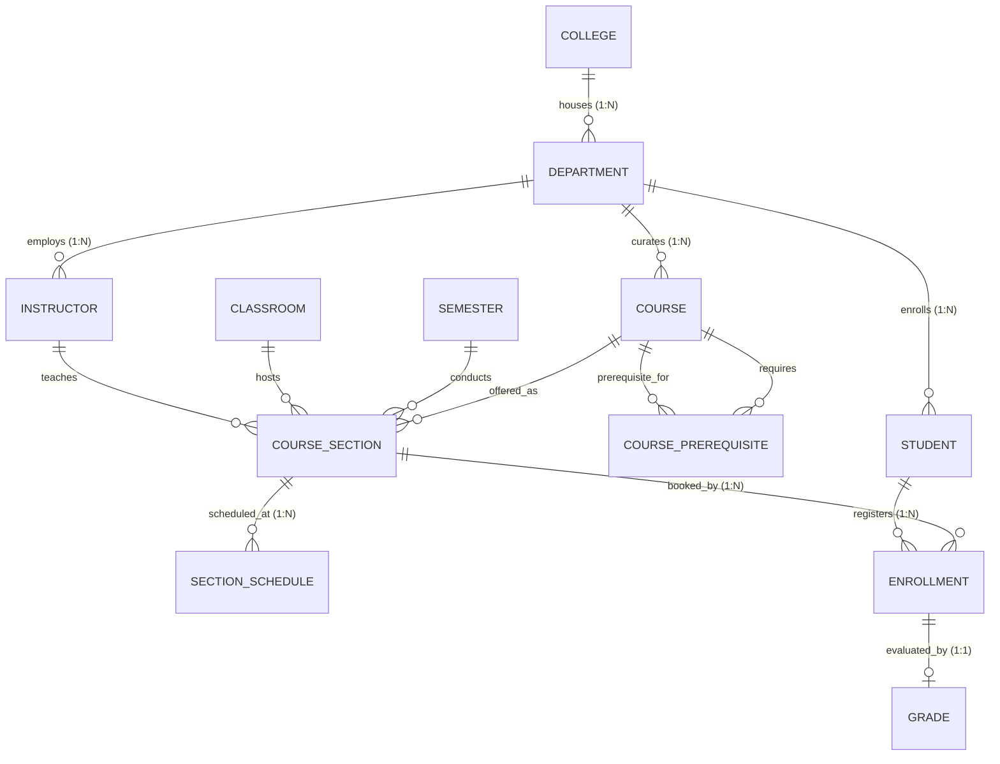

<div align="center">

# 🎓 University Academic Management System
### *Enterprise-Grade Academic Hierarchy, Registration Pipeline & GPA Engine*

[](https://dotnet.microsoft.com/)
[](https://docs.microsoft.com/en-us/dotnet/csharp/)
[](https://docs.microsoft.com/en-us/ef/core/)
[](https://www.microsoft.com/sql-server)
[](https://spectreconsole.net/)
[](https://en.wikipedia.org/wiki/Multitier_architecture)

<br/>

> **A mission-critical academic management system built with C#, Entity Framework Core (Code-First), and Microsoft SQL Server.**  
> Featuring an in-depth DFS Graph Cycle Detection Engine, an 11-Rule Course Registration Pipeline, Mathematical Collision Detection for Classrooms/Instructors, and a full Cumulative GPA Engine with Historical Retake Replacement Policy.

---

</div>

## 📑 Table of Contents
- [✨ Architectural Highlights](#-architectural-highlights)
- [🏛️ Domain Architecture & ERD](#️-domain-architecture--erd)
- [⚙️ Core Business Engines](#️-core-business-engines)
  - [1. DFS Graph Cycle Detection Engine](#1-dfs-graph-cycle-detection-engine)
  - [2. Multi-Dimensional Schedule Collision Engine](#2-multi-dimensional-schedule-collision-engine)
  - [3. The 11-Rule Registration Pipeline](#3-the-11-rule-registration-pipeline)
  - [4. Academic Grading & Retake GPA Engine](#4-academic-grading--retake-gpa-engine)
- [📊 Integrated Academic Analytics & Transcripts](#-integrated-academic-analytics--transcripts)
- [🏛️ System Functional Modules](#️-system-functional-modules)
- [📂 Project Directory Structure](#-project-directory-structure)
- [🚀 Quick Start & Installation](#-quick-start--installation)
- [🧪 Acceptance Criteria & Verified Scenarios](#-acceptance-criteria--verified-scenarios)

---

## ✨ Architectural Highlights

* **Solid Domain-Driven Core:** 12 relational entity models mapped via Fluent API with strict referential integrity (`DeleteBehavior.Restrict` on academic hierarchies to prevent cascade-delete data loss).
* **Graph Algorithms in Production:** Depth-First Search (DFS) algorithm with cycle prevention to secure the academic prerequisites tree from recursive or circular deadlocks.
* **Interval Math for Collisions:** Accurate algebraic time-slice overlapping algorithm: `(Start_A < End_B) && (End_A > Start_B)` safeguarding rooms, instructors, and student schedules.
* **Smart Transcript & Retake Calculations:** Dynamic GPA computation where previous failed attempts are systematically superseded by the latest course attempt in CGPA and earned hours calculations.
* **Industrial Console UX:** Built using Spectre.Console with robust error isolation, graceful input parsing (`ConsoleHelper`), formatted tables, color-coded statuses, and 10 interactive domain menus.

---

## 🏛️ Domain Architecture & ERD

The system is engineered around **12 Relational Entities** backed by **11 Specialized Enumerations**:



### Relational Schema Summary:
1. **`College`**: Top-level academic institution (`Code`, `Name`, `Description`).
2. **`Department`**: Specialized academic units (`Code`, `Name`, `CollegeId`).
3. **`Student`**: Automated sequential university identification (`ST0001`, `ST0002`...), `DateOfBirth` ($\ge 16\text{ yrs}$), `AcademicLevel`, `Status`.
4. **`Instructor`**: Academic faculty members (`AcademicTitle`, `HireDate`, `Status`, `DepartmentId`).
5. **`Course`**: Curricular subjects (`Code`, `Name`, `CreditHours` [1-6], `AcademicLevel`).
6. **`CoursePrerequisite`**: Self-referential graph link (`CourseId`, `PrerequisiteCourseId`) with composite primary keys.
7. **`Semester`**: Academic terms (`Name`, `AcademicYear`, `StartDate`, `EndDate`, `Status` [Upcoming $\to$ Active $\to$ Completed]).
8. **`Classroom`**: Venues & Labs (`Building`, `RoomNumber`, `Capacity`).
9. **`CourseSection`**: Running cohorts of a course (`SectionNumber`, `Capacity` $\le$ Room Capacity).
10. **`SectionSchedule`**: Weekly timetables (`DayOfWeek`, `StartTime`, `EndTime` with duration $\ge 45\text{ mins}$).
11. **`Enrollment`**: Student-Section binding (`RegistrationDate`, `Status` [Registered, Dropped, Completed]).
12. **`Grade`**: Academic evaluation (`Midterm` [0-20], `Practical` [0-20], `Final` [0-60], `Total` [0-100], `LetterGrade`, `GradePoint`).

---

## ⚙️ Core Business Engines

### 1. DFS Graph Cycle Detection Engine
Prevents circular dependency deadlocks across course prerequisites.
$$\text{If Course } A \to B \to \dots \to C \text{, adding } C \to A \text{ is systematically rejected.}$$

* **Algorithm:** Iterative Depth-First Search with backtracking state tracking (`Stack<int>` & `HashSet<int>`).
* **Level Integrity:** Enforces that $\text{Prerequisite.Level} \le \text{Course.Level}$ (e.g., Year 3 course cannot be a prerequisite for a Year 1 course).

```csharp
public bool HasCycle(int courseId, int newPrereqId)
{
    if (courseId == newPrereqId) return true;

    var visited = new HashSet<int>();
    var stack = new Stack<int>();
    stack.Push(newPrereqId);

    while (stack.Count > 0)
    {
        var currentId = stack.Pop();
        if (currentId == courseId)
            return true; 

        if (visited.Add(currentId))
        {
            var parentPrereqs = _context.CoursePrerequisites
                .Where(cp => cp.CourseId == currentId)
                .Select(cp => cp.PrerequisiteCourseId)
                .ToList();

            foreach (var prereq in parentPrereqs)
            {
                if (!visited.Contains(prereq))
                    stack.Push(prereq);
            }
        }
    }
    return false;
}
```

---

### 2. Multi-Dimensional Schedule Collision Engine
Protects against physical and temporal conflicts in lectures across the university:

$$\text{Collision}(A, B) \iff (\text{Start}_A < \text{End}_B) \land (\text{End}_A > \text{Start}_B) \quad \text{on the same day and semester}$$

* **Classroom Conflict:** Guarantees that no two sections share the same hall at overlapping times.
* **Instructor Conflict:** Guarantees that no instructor is booked for multiple lectures simultaneously.
* **Internal Section Conflict:** Prevents self-overlapping timetable slots for the same section.
* **Teaching Load Quota:** Caps maximum teaching assignments at $5\text{ sections}$ per instructor per semester.
* **Minimum Duration Enforcement:** Ensures lecture sessions are at least 45 minutes long.

---

### 3. The 11-Rule Registration Pipeline
Every enrollment request undergoes an atomic pipeline execution:

```
[Student Request] 
       │
       ▼
 [R1: Timetable Exists?] ──────────► (No) ──► ❌ REJECT: Section has no timetable
       │ (Yes)
 [R2: Student Active?] ────────────► (No) ──► ❌ REJECT: Suspended/Withdrawn student
       │ (Yes)
 [R3: Semester Active?] ───────────► (No) ──► ❌ REJECT: Term is not Active
       │ (Yes)
 [R4: Already Enrolled?] ──────────► (Yes) ─► ❌ REJECT: Duplicate section enrollment
       │ (No)
 [R5: Duplicate Course in Term?] ──► (Yes) ─► ❌ REJECT: Already registered in another section
       │ (No)
 [R6: Already Passed Course?] ─────► (Yes) ─► ❌ REJECT: Course already completed with Total >= 60
       │ (No)
 [R7: Prerequisites Passed?] ──────► (No) ──► ❌ REJECT: Missing prerequisite courses
       │ (Yes)
 [R8: Academic Level Compatible?] ─► (No) ──► ❌ REJECT: Course level > Student level
       │ (Yes)
 [R9: Student Schedule Conflict?] ─► (Yes) ─► ❌ REJECT: Overlaps with student's timetable
       │ (No)
 [R10: Section Capacity Available?]► (No) ──► ❌ REJECT: Section is full
       │ (Yes)
 [R11: Credit Hours Under Cap?] ───► (No) ──► ❌ REJECT: Max 18 hrs (12 hrs for Probation)
       │ (Yes)
       ▼
 [Reactivate if Dropped / Create New Registration] ──► ✔️ ENROLLMENT APPROVED
```

---

### 4. Academic Grading & Retake GPA Engine

#### Unified Grading Scale:
| Total Score Range | Letter Grade | Grade Point | Academic Result |
|:---:|:---:|:---:|:---:|
| **90.00 – 100.00** | **A** | **4.00** | Pass (Excellent) |
| **85.00 – 89.99** | **B+** | **3.50** | Pass (Very Good) |
| **80.00 – 84.99** | **B** | **3.00** | Pass (Very Good) |
| **75.00 – 79.99** | **C+** | **2.50** | Pass (Good) |
| **70.00 – 74.99** | **C** | **2.00** | Pass (Good) |
| **65.00 – 69.99** | **D+** | **1.50** | Pass (Acceptable) |
| **60.00 – 64.99** | **D** | **1.00** | Pass (Acceptable) |
| **0.00 – 59.99** | **F** | **0.00** | Fail |

#### Historical Retake Replacement:
When a student repeats a course they previously failed, the **Latest Attempt** supersedes past attempts in Cumulative GPA (CGPA) and earned hours calculations:

$$\text{CGPA} = \frac{\sum_{c \in \text{LatestAttempts}} (\text{GradePoint}_c \times \text{CreditHours}_c)}{\sum_{c \in \text{LatestAttempts}} \text{CreditHours}_c}$$

$$\text{Academic Standing} = \begin{cases} 
\text{Excellent} & \text{CGPA} \ge 3.50 \\
\text{Very Good} & 3.00 \le \text{CGPA} < 3.50 \\
\text{Good} & 2.50 \le \text{CGPA} < 3.00 \\
\text{Pass} & 2.00 \le \text{CGPA} < 2.50 \\
\text{Probation (Warning)} & \text{CGPA} < 2.00 
\end{cases}$$

$$\text{Graduation Requirement} \iff \text{Earned Hours} \ge 120 \quad \land \quad \text{CGPA} \ge 2.00$$

---

## 📊 Integrated Academic Analytics & Transcripts

The system features real-time, LINQ-powered analytical queries embedded directly into the core domain workflows:

1. **Student Official Transcript (`StudentTranscriptDto`):** Full term-by-term academic history showing course grades, semester GPAs, historical retakes, overall CGPA, earned hours, and graduation eligibility audit.
2. **Term-by-Term GPA Calculator:** Dynamic calculation of quality points and total hours for any completed academic semester.
3. **Cumulative GPA & Academic Standing Engine:** Real-time computation of CGPA and standing (Excellent, Very Good, Good, Pass, Probation) with retake replacement.
4. **Section Grade Sheets:** Complete grade roster displaying Midterm, Practical, Final, Total, Letter Grade, and Grade Points for all students in a section.
5. **Student Schedule Roster:** Visualized weekly timetable for enrolled students displaying day, start time, end time, course, and assigned classroom.
6. **Live Capacity & Roster Inquiries:** Real-time tracking of filled seats versus room capacities.

---

## 🏛️ System Functional Modules

| # | Module | Core Responsibilities | Key Entities & Services | UI Menu |
|:---:|:---|:---|:---|:---|
| **1** | **Colleges** | Institutional management, college codes, names, and descriptions. | `College`, `CollegeService` | Menu 1 |
| **2** | **Departments** | Specialized department units, unique code validation, college mapping. | `Department`, `DepartmentService` | Menu 2 |
| **3** | **Students** | Sequential ID generation (`ST0001`), age validation ($\ge 16$), status lifecycle. | `Student`, `StudentService` | Menu 3 |
| **4** | **Instructors** | Faculty records, department affiliation, academic status, teaching quota. | `Instructor`, `InstructorService` | Menu 4 |
| **5** | **Courses & Graph** | Course catalogs, credit hours, levels, and DFS cycle detection engine. | `Course`, `CoursePrerequisite`, `CourseService` | Menu 5 |
| **6** | **Semesters** | Academic term scheduling, single active semester constraint enforcement. | `Semester`, `SemesterService` | Menu 6 |
| **7** | **Classrooms** | Venue registration, building locations, and room capacity limits. | `Classroom`, `ClassroomService` | Menu 7 |
| **8** | **Course Sections** | Section creation, timetable slots, and interval collision detection. | `CourseSection`, `SectionSchedule`, `SectionService` | Menu 8 |
| **9** | **Registration Pipeline** | Atomic 11-step course enrollment, schedule overlap check, and drop policy. | `Enrollment`, `RegistrationService` | Menu 9 |
| **10** | **Grades & GPA Engine**| Grade entry, retake replacement, GPA/CGPA calculation, and official transcripts. | `Grade`, `GradeServices`, `GpaService` | Menu 10 |

---

## 📂 Project Directory Structure

```plaintext
University_Academic/
├── 📁 Configurations/          # Fluent API EntityTypeConfiguration mappings
│   ├── CollegeConfiguration.cs
│   ├── DepartmentConfiguration.cs
│   ├── CourseConfiguration.cs
│   ├── CoursePrerequisiteConfiguration.cs
│   ├── CourseSectionConfiguration.cs
│   ├── SectionScheduleConfiguration.cs
│   ├── StudentConfiguration.cs
│   ├── InstructorConfiguration.cs
│   ├── SemesterConfiguration.cs
│   ├── ClassroomConfiguration.cs
│   └── GradeConfiguration.cs
├── 📁 Data/                    # DbContext & Runtime Factory
│   ├── UniversityDbContext.cs
│   └── ApplicationDbContextFactory.cs
├── 📁 Entities/                # Pure Domain Model classes (12 Entities)
│   ├── College.cs, Department.cs, Course.cs, Student.cs, Instructor.cs...
│   ├── CoursePrerequisite.cs, CourseSection.cs, SectionSchedule.cs...
│   └── Enrollment.cs, Classroom.cs, Semester.cs, Grade.cs
├── 📁 Enums/                   # System-wide Enumerations (11 Enums)
│   ├── AcademicLevel.cs, SemesterStatus.cs, LetterGrade.cs, AcademicStanding.cs...
│   ├── EnrollmentStatus.cs, StudentStatus.cs, InstructorStatus.cs, StudyDayOfWeek.cs...
├── 📁 Helper_Function/         # Utilities, Defensive input reader & Result pattern
│   ├── ConsoleHelper.cs        # Crash-proof input validation engine
│   └── ServiceResult.cs       # Generic ServiceResult<T> pattern
├── 📁 Services/                # Business logic engines & validations (11 Services)
│   ├── CollegeService.cs, DepartmentService.cs, StudentService.cs...
│   ├── InstructorService.cs, CourseService.cs, SemesterService.cs...
│   ├── ClassroomService.cs, SectionService.cs...
│   ├── RegistrationService.cs # 11-step registration pipeline
│   ├── GradeServices.cs       # Grade evaluation and recording
│   └── GpaService.cs          # Retake-aware GPA calculator & Transcript DTOs
├── 📁 UI/                      # Interactive Spectre.Console menus (10 Menus)
│   ├── MainMenu.cs            # Orchestrator menu
│   ├── CollegeMenu.cs, DepartmentMenu.cs, StudentMenu.cs, InstructorMenu.cs...
│   ├── CourseMenu.cs, SemesterMenu.cs, ClassroomMenu.cs, SectionMenu.cs...
│   └── RegistrationMenu.cs, GradeMenu.cs
├── 📄 DataSeeder.cs            # Realistic automated dataset seeder (1050+ lines)
├── 📄 Program.cs               # Application entry point & service composition
└── 📄 appsettings.json         # Connection string configuration
```

---

## 🚀 Quick Start & Installation

### Prerequisites
* [.NET 10.0 SDK](https://dotnet.microsoft.com/download/dotnet)
* [Microsoft SQL Server](https://www.microsoft.com/en-us/sql-server/sql-server-downloads) (LocalDB, Express, or Developer edition)

### Setup Instructions

1. **Navigate to the project folder:**
   ```bash
   cd University_Academic
   ```

2. **Configure Database Connection:**
   Ensure `appsettings.json` points to your active SQL Server instance:
   ```json
   {
     "ConnectionStrings": {
       "DefaultConnection": "Server=.;Database=UniversityAcademicDb;Trusted_Connection=True;TrustServerCertificate=True;"
     }
   }
   ```

3. **Apply Migrations & Create Database:**
   ```bash
   dotnet ef database update
   ```

4. **Run the Application:**
   ```bash
   dotnet run
   ```

---

## 🧪 Acceptance Criteria & Verified Scenarios

The system has been strictly engineered and verified against core domain scenarios:

* ✔️ **`AC-01` Single Active Semester:** Attempting to activate a semester while another is active throws a business validation exception.
* ✔️ **`AC-02` Circular Prerequisites:** Attempting to assign `CS101` as a prerequisite for `CS102` when `CS102` already requires `CS101` is intercepted and blocked by the DFS engine.
* ✔️ **`AC-03` Prerequisite Level Integrity:** Year 3 courses cannot be assigned as prerequisites for Year 1 courses.
* ✔️ **`AC-04` Instructor Department Alignment:** An instructor from `IT` cannot be assigned to teach a `CS` department section.
* ✔️ **`AC-05` Section Capacity Cap:** Section capacity cannot exceed the designated classroom's maximum capacity.
* ✔️ **`AC-06` Timetable Room Overlap:** Booking the same classroom at overlapping intervals triggers collision detection.
* ✔️ **`AC-07` Timetable Instructor Overlap:** Assigning an instructor to two different lectures at overlapping times is blocked.
* ✔️ **`AC-08` Inactive Student Registration:** Suspended (`Suspended`) or withdrawn students are rejected immediately at pipeline Step 2.
* ✔️ **`AC-09` Missing Prerequisites:** Students attempting to register for advanced courses without passing all prerequisite courses with $\text{Total} \ge 60$ are rejected with the list of missing courses.
* ✔️ **`AC-10` Student Schedule Overlap:** Registering for two sections with conflicting times on the same day is caught and rejected.
* ✔️ **`AC-11` Academic Probation Hour Ceiling:** Students on academic probation ($\text{CGPA} < 2.00$) cannot register for more than $12\text{ credit hours}$.
* ✔️ **`AC-12` Full Section Rejection:** Enrollments exceeding section capacity are blocked.
* ✔️ **`AC-13` Drop and Reactivation:** Dropping an active course and re-enrolling reactivates the historical row without primary/unique key violations.
* ✔️ **`AC-14` Retake GPA Calculation:** Passing a repeated course replaces the earlier attempt in CGPA calculation while preserving academic history in the transcript.

---

<div align="center">

Made with dedication by the **Engineering Development Team**  
*Graduation Project / Mini Project — Academic Year 2026*

</div>
