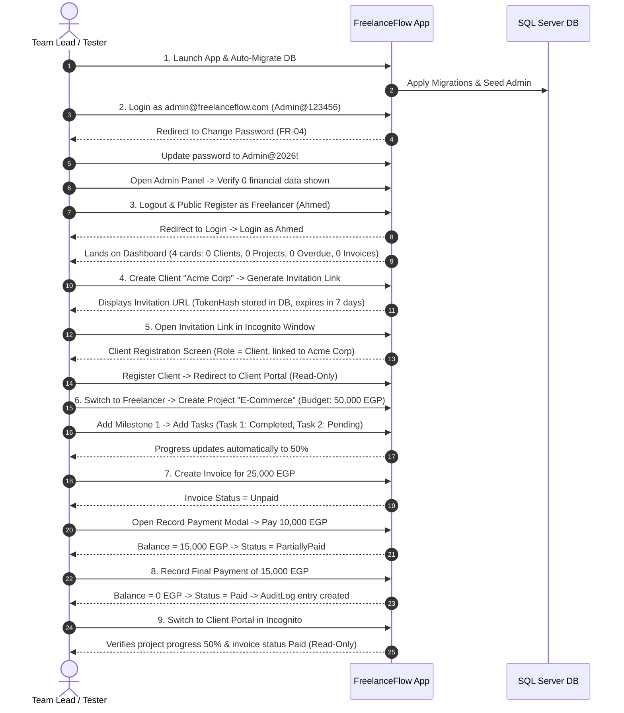

# ASP.NET Core 3-Tier Architecture — Data Access Layer & Team Lead Master Guide

## Project: FreelanceFlow — Freelancer & Client Management System 🛡️
### Role: Team Lead (Member 5) — DAL Architect, Integrator & Project Manager

---

## 1. Overview & Architectural Role

As the **Team Lead (Member 5)**, you hold the central responsibility for the project's technical integrity, data architecture, team coordination, and final delivery. 

Your domain covers three core pillars:
1. **The Data Access Layer (`App.DAL`)**: Designing the data models, EF Core configurations, migrations, concurrency tokens, Identity integration, and seed data.
2. **System Assembly & Integration ("شغل التجميع")**: Wiring the dependencies in `Program.cs`, configuring the cookie authentication pipeline, and ensuring the three layers (`DAL → BLL → MVC`) communicate seamlessly.
3. **Pull Request Gatekeeping & Code Review**: Enforcing project-wide rules (BR-01 through BR-31 and NFR-01 through NFR-14), preventing architectural violations, and orchestrating Git branches.

---

## 2. Solution Architecture & File Organization

The solution `FreelancerFlow.slnx` consists of three projects:

```text
FreelancerFlow.slnx
│
├── 📁 App.DAL                              (Class Library - .NET 10.0) [Owned by Team Lead]
│   ├── 📁 Data
│   │   ├── AppDbContext.cs                 (IdentityDbContext<User>)
│   │   ├── DbInitializer.cs                (Seed: Roles, Admin, Demo Data)
│   │   └── 📁 Configurations
│   │       ├── UserConfiguration.cs
│   │       ├── ClientConfiguration.cs
│   │       ├── ProjectConfiguration.cs
│   │       ├── MilestoneConfiguration.cs
│   │       ├── TaskConfiguration.cs
│   │       ├── InvoiceConfiguration.cs
│   │       ├── PaymentConfiguration.cs
│   │       ├── InvitationConfiguration.cs
│   │       └── AuditLogConfiguration.cs
│   ├── 📁 Entities
│   │   ├── User.cs                         (: IdentityUser)
│   │   ├── Client.cs
│   │   ├── Project.cs
│   │   ├── Milestone.cs
│   │   ├── TaskItem.cs
│   │   ├── Invoice.cs
│   │   ├── Payment.cs
│   │   ├── Invitation.cs
│   │   └── AuditLog.cs
│   ├── 📁 Enums
│   │   ├── UserRole.cs
│   │   ├── ProjectStatus.cs
│   │   ├── TaskItemStatus.cs
│   │   ├── MilestoneStatus.cs
│   │   ├── InvoiceStatus.cs
│   │   ├── ProjectHealth.cs
│   │   ├── Currency.cs
│   │   └── Priority.cs
│   └── 📁 Migrations
│
├── 📁 App.BLL                              (Class Library - .NET 10.0) [Owned by BLL Team]
└── 📁 App.Mvc                              (ASP.NET Core Web App MVC - .NET 10.0) [Owned by MVC Team]
```

---

## 3. Section 1: Data Access Layer (`App.DAL`) Specifications

### 3.1 NuGet Packages
* `Microsoft.EntityFrameworkCore.SqlServer` (EF Core database provider)
* `Microsoft.AspNetCore.Identity.EntityFrameworkCore` (Identity tables integration)
* `Microsoft.EntityFrameworkCore.Tools` (Migrations support)

### 3.2 Schema & Entity Mapping Table (Section 7)

| Table | Primary Key | Key Columns & Precision | Constraints & Foreign Keys |
| :--- | :--- | :--- | :--- |
| **`AspNetUsers`** | `Id` (string) | `FullName` (nvarchar 100)<br>`Role` (int / nvarchar 20)<br>`ClientId` (int, nullable)<br>`IsActive` (bool)<br>`MustChangePassword` (bool)<br>`CreatedAtUtc` (datetime2) | Email is unique.<br>Unique index on `ClientId` (nullable).<br>Links to `Clients` (Restrict). |
| **`Clients`** | `ClientID` (int) | `CompanyName` (nvarchar 150)<br>`Phone` (nvarchar 20)<br>`Address` (nvarchar 250)<br>`Notes` (nvarchar max)<br>`IsDeleted` (bool)<br>`DeletedAtUtc` (datetime2, nullable) | `UserID` (FK → `AspNetUsers.Id`, Restrict).<br>Soft-deleted clients remain in DB. |
| **`Projects`** | `ProjectID` (int) | `Name` (nvarchar 150)<br>`Budget` (decimal 18,2)<br>`Currency` (nvarchar 10: EGP/USD/EUR)<br>`Status` (nvarchar 20)<br>`StartDate` (date)<br>`Deadline` (date) | `ClientID` (FK → `Clients.ClientID`, Restrict).<br>`Deadline > StartDate`. |
| **`Milestones`** | `MilestoneID` (int) | `Name` (nvarchar 150)<br>`DueDate` (date)<br>`SortOrder` (int) | `ProjectID` (FK → `Projects.ProjectID`, **Cascade Delete**). |
| **`Tasks`** | `TaskID` (int) | `Title` (nvarchar 200)<br>`Priority` (int: Low/Med/High)<br>`Status` (nvarchar 20)<br>`DueDate` (date)<br>`SortOrder` (int) | `MilestoneID` (FK → `Milestones.MilestoneID`, **Cascade Delete**). |
| **`Invoices`** | `InvoiceID` (int) | `Amount` (decimal 18,2)<br>`Currency` (nvarchar 10)<br>`IssueDate` (date)<br>`DueDate` (date)<br>`RowVersion` (rowversion / byte[8]) | `ProjectID` (FK → `Projects.ProjectID`, Restrict).<br>`RowVersion` is concurrency token. |
| **`Payments`** | `PaymentID` (int) | `Amount` (decimal 18,2)<br>`Currency` (nvarchar 10)<br>`PaymentDate` (date)<br>`Notes` (nvarchar 500) | `InvoiceID` (FK → `Invoices.InvoiceID`, Restrict). |
| **`Invitations`**| `InvitationID` (int)| `Email` (nvarchar 150)<br>`TokenHash` (nvarchar 128)<br>`ExpiresAtUtc` (datetime2)<br>`UsedAtUtc` (datetime2, nullable)<br>`RevokedAtUtc` (datetime2, nullable) | `ClientID` (FK → `Clients.ClientID`, Restrict).<br>`TokenHash` is unique. |
| **`AuditLogs`** | `AuditLogID` (int) | `EntityName` (nvarchar 50)<br>`EntityID` (int)<br>`Action` (nvarchar 50)<br>`OldValues` (nvarchar max)<br>`NewValues` (nvarchar max)<br>`CreatedAtUtc` (datetime2) | `UserID` (FK → `AspNetUsers.Id`, nullable, Restrict). |

### 3.3 Deletion Cascades vs. Restrict Rules (Section 7)
* **Cascade Deletion**: `Tasks → Milestones → Projects`.
  * When a Project is deleted (permitted only if it has no invoices, BR-06), its Milestones and Tasks cascade delete automatically.
* **Restrict Deletion**: All other relationships:
  * A Client cannot be hard-deleted (only soft-deleted, BR-05).
  * A Project with Invoices cannot be deleted (Restrict, BR-06).
  * An Invoice with Payments cannot be deleted (Restrict, BR-21).

### 3.4 Optimistic Concurrency Token (`Invoice.RowVersion`)
In `InvoiceConfiguration.cs`, configure:
```csharp
builder.Property(i => i.RowVersion).IsRowVersion();
```
* On SQL Server, this generates a `rowversion` column that automatically increments whenever an invoice row updates.
* When payments are recorded, EF Core includes `WHERE RowVersion = @originalRowVersion`. If another payment or update was recorded concurrently, EF Core throws a `DbUpdateConcurrencyException`, preventing overpayment under concurrent requests (NFR-11, BR-19).

### 3.5 ASP.NET Core Identity Integration
`AppDbContext` inherits from `IdentityDbContext<User>`:
```csharp
public class AppDbContext : IdentityDbContext<User>
{
    public AppDbContext(DbContextOptions<AppDbContext> options) : base(options) { }

    public DbSet<Client> Clients => Set<Client>();
    public DbSet<Project> Projects => Set<Project>();
    public DbSet<Milestone> Milestones => Set<Milestone>();
    public DbSet<TaskItem> Tasks => Set<TaskItem>();
    public DbSet<Invoice> Invoices => Set<Invoice>();
    public DbSet<Payment> Payments => Set<Payment>();
    public DbSet<Invitation> Invitations => Set<Invitation>();
    public DbSet<AuditLog> AuditLogs => Set<AuditLog>();

    protected override void OnModelCreating(ModelBuilder modelBuilder)
    {
        base.OnModelCreating(modelBuilder);
        modelBuilder.ApplyConfigurationsFromAssembly(typeof(AppDbContext).Assembly);
    }
}
```

### 3.6 EF Core Migrations Commands (Run from Solution Root)
```powershell
# Create Migration
dotnet ef migrations add InitialCreate --project App.DAL --startup-project App.Mvc

# Apply to SQL Server Database
dotnet ef database update --project App.DAL --startup-project App.Mvc
```

---

## 4. Section 2: Data Seeding Strategy (`DbInitializer.cs`)

`DbInitializer.SeedAsync` runs automatically upon application startup. It satisfies requirements **FR-04** and **FR-31**:

### 4.1 System Roles & Admin User (FR-04)
1. Seeds Identity Roles: `"Admin"`, `"Freelancer"`, `"Client"`.
2. Checks if the Admin account exists. If not, creates:
   * **Username / Email**: `admin@freelanceflow.com`
   * **Password**: `Admin@123456`
   * **Role**: `UserRole.Admin`
   * **`MustChangePassword`**: `true` (forces password change on first login).
   * **`IsActive`**: `true`.

### 4.2 Comprehensive Demo Data Seeding (FR-31 & Section 11)
For automated grading and acceptance testing, provide a seed method or flag that populates:
1. **Freelancer Account**:
   * Name: `Ahmed Mohamed`, Email: `ahmed@freelanceflow.com`, Password: `Password@123`.
2. **Client**:
   * Company Name: `Acme Corporation`, Phone: `+20 100 123 4567`, Address: `Smart Village, Giza`.
3. **Projects (2 Projects)**:
   * **Project 1**: `E-Commerce Platform` (Budget: `50,000 EGP`, Status: `InProgress`).
     * Milestone 1: `Backend API & Auth` (DueDate: 10 days ahead).
       * Task 1: `Setup JWT Auth` (`Completed`).
       * Task 2: `Products CRUD` (`Completed`).
     * Milestone 2: `Frontend Integration` (DueDate: 25 days ahead).
       * Task 3: `Cart Component` (`InProgress`).
       * Task 4: `Checkout Flow` (`Pending`).
     * Invoice 1: Amount `25,000 EGP` (DueDate: Today).
       * Payment 1: Amount `15,000 EGP` (Partially Paid).
   * **Project 2**: `Corporate Website` (Budget: `15,000 EGP`, Status: `Completed`).
     * All tasks completed, progress 100%, invoice fully paid.

---

## 5. Section 3: System Assembly & Wiring ("شغل التجميع")

The Team Lead is responsible for configuring `App.Mvc/Program.cs` to tie all three layers together.

### 5.1 Service Registration Pipeline (`Program.cs`)
```csharp
var builder = WebApplication.CreateBuilder(args);

// 1. Controllers & Razor Views
builder.Services.AddControllersWithViews();

// 2. Data Access Layer & SQL Server
builder.Services.AddDbContext<AppDbContext>(options =>
    options.UseSqlServer(builder.Configuration.GetConnectionString("DefaultConnection")));

// 3. Identity Services Configuration
builder.Services.AddIdentity<User, IdentityRole>(options =>
{
    options.Password.RequireDigit = true;
    options.Password.RequiredLength = 8;
    options.Password.RequireNonAlphanumeric = false;
    options.Password.RequireUppercase = true;
    options.Password.RequireLowercase = true;
    options.User.RequireUniqueEmail = true;
})
.AddEntityFrameworkStores<AppDbContext>()
.AddDefaultTokenProviders();

// 4. Application Cookie Settings
builder.Services.ConfigureApplicationCookie(options =>
{
    options.Cookie.Name = "FreelanceFlow.AuthCookie";
    options.Cookie.HttpOnly = true;
    options.ExpireTimeSpan = TimeSpan.FromHours(2);
    options.SlidingExpiration = true;
    options.LoginPath = "/Account/Login";
    options.AccessDeniedPath = "/Account/AccessDenied";
});

// 5. Business Logic Layer Registration (from App.BLL)
builder.Services.AddBLL();

var app = builder.Build();

// 6. Automatic Startup Migration & Seeding
using (var scope = app.Services.CreateScope())
{
    var services = scope.ServiceProvider;
    try
    {
        await DbInitializer.SeedAsync(services);
    }
    catch (Exception ex)
    {
        var logger = services.GetRequiredService<ILogger<Program>>();
        logger.LogError(ex, "An error occurred during database migration/seeding.");
    }
}

// 7. HTTP Request Pipeline Configuration
if (!app.Environment.IsDevelopment())
{
    app.UseExceptionHandler("/Home/Error");
    app.UseHsts();
}

app.UseHttpsRedirection();
app.UseRouting();

// CRITICAL ORDER: Authentication MUST precede Authorization
app.UseAuthentication();
app.UseAuthorization();

app.MapStaticAssets();

app.MapControllerRoute(
    name: "default",
    pattern: "{controller=Home}/{action=Index}/{id?}")
    .WithStaticAssets();

app.Run();
```

---

## 6. Section 4: Git Workflow & Pull Request Gatekeeping (Review Checklist)

### 6.1 Branching Strategy (NFR-12)
* **`main`**: Production-ready branch. Only merged from `develop` via pull request.
* **`develop`**: Integration branch where all team members merge their features.
* **Feature Branches**:
  * BLL Dev 1: `feat/bll-client-project-tasks`
  * BLL Dev 2: `feat/bll-invoices-payments-auth`
  * MVC Dev 1: `feat/mvc-auth-admin-portal-dashboard`
  * MVC Dev 2: `feat/mvc-clients-projects-invoices`

### 6.2 The 10 Golden PR Review Criteria
Before approving and merging any Pull Request into `develop`, verify each rule:

1. **Compilation**: The solution builds cleanly with **0 Warnings and 0 Errors**.
2. **Architectural Separation**: The MVC layer contains **no reference to `AppDbContext`**. All queries call BLL interfaces.
3. **Clock Discipline**: **Zero occurrences of `DateTime.Now`**. All time calculations inject and use `IClock`.
4. **Monetary Typing**: All financial values are `decimal`. No `double` or `float` casts.
5. **Pure Calculations**: Calculation functions (`CalculateProgress`, `CalculateHealth`, `CalculateInvoiceStatus`) are pure, testable, and covered by xUnit tests.
6. **Financial Concurrency**: Payment recording executes inside a database transaction, checks balance on DB level, and catches `DbUpdateConcurrencyException`.
7. **Soft Delete**: Clients are soft-deleted (`IsDeleted = true`). No hard deletes on `Clients`.
8. **CSRF & Security**: Every form post uses `@Html.AntiForgeryToken()` and carries `[ValidateAntiForgeryToken]`.
9. **Admin Boundaries (BR-28)**: Admin views and controllers display zero financial data.
10. **UI Empty States**: All empty tables are replaced by styled Bootstrap cards/alerts with call-to-action buttons.

---

## 7. Section 5: End-to-End Acceptance Test Walkthrough (Section 11)

Perform this manual verification scenario before final project delivery:



---

## 📋 Team Lead Evaluation & Delivery Checklist

- [ ] **Data Access Layer**: All 9 entities configured with separate `IEntityTypeConfiguration<T>` classes.
- [ ] **RowVersion**: `Invoice.RowVersion` configured with `.IsRowVersion()` for optimistic concurrency.
- [ ] **Cascade Rules**: `Tasks → Milestones → Projects` cascade delete; all other relationships restrict.
- [ ] **Identity & Cookie Auth**: Application cookie configured with sliding expiration, correct Login and AccessDenied paths.
- [ ] **Startup Migration**: `DbInitializer` runs `Database.MigrateAsync()` and seeds Admin account safely.
- [ ] **Integration in Program.cs**: `AddDbContext`, `AddIdentity`, `AddBLL`, `UseAuthentication`, `UseAuthorization` wired in correct sequence.
- [ ] **Code Review**: All 4 team members' branches reviewed against the 10 Golden Criteria.
- [ ] **End-to-End Walkthrough**: The full Section 11 acceptance scenario passes without errors.
- [ ] **Documentation**: `README.md`, `CONTRIBUTING.md`, and task specifications are updated and clean.
